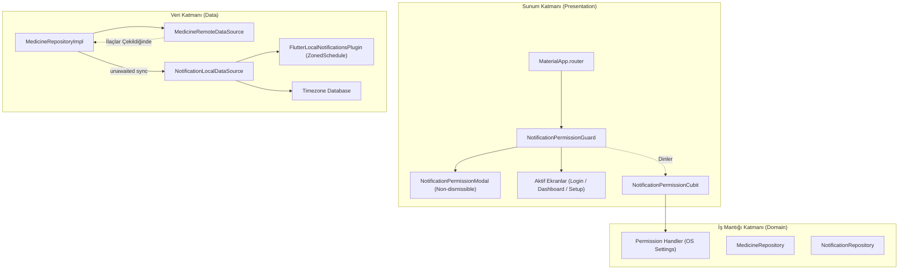

# Bildirim İzni Kalkanı ve İlaç Senkronizasyonu Entegrasyon Raporu

Bu doküman; **Zorunlu Bildirim İzni Kalkanı (Hard-Block Modal)** ve **İlaç Hatırlatıcı Yerel Bildirim Senkronizasyonu (Local Notification Diff & Sync)** özelliklerinin mimariye entegrasyonunu, eklenen dosyaları, değiştirilen mantıkları ve konfigürasyonları içermektedir.

---

## 1. Genel Mimari Bakış

Uygulanan mimari; **Clean Architecture**, **BLoC (Cubit)** state management, **Injectable/GetIt** dependency injection ve **GoRouter** prensiplerine tam uyumlu şekilde kurgulanmıştır:



---

## 2. Yapılan Değişiklikler ve Dosya Haritası

| Katman / Kategori | Dosya Yolu | Yapılan İşlem |
| :--- | :--- | :--- |
| **Bağımlılıklar** | `pubspec.yaml` | `permission_handler: ^11.4.0` eklendi. |
| **Android Manifest** | `android/app/src/main/AndroidManifest.xml` | Exact alarm izinleri ve local notifications receiver tanımları eklendi. |
| **Data Source** | `lib/features/notifications/data/datasources/notification_local_data_source.dart` | `syncMedicationReminders`, deterministik ID üretimi, timezone ve alarm kanalı eklendi. |
| **Domain Repository** | `lib/features/notifications/domain/repository/notification_repository.dart` | `syncMedicationReminders` ve `cancelMedicationReminders` sözleşmeleri eklendi. |
| **Data Repository** | `lib/features/notifications/data/repositories/notification_repository_impl.dart` | Local data source köprüsü sağlandı. |
| **Medication Repository** | `lib/features/medication/data/repositories/medicine_repository_impl.dart` | `NotificationLocalDataSource` enjekte edildi; `getMedicines` ve `deleteMedicine` senkronizasyona bağlandı. |
| **BLoC / State** | `lib/features/notifications/presentation/bloc/notification_permission_state.dart` | İzin durumları tanımlandı (`Initial`, `Checking`, `Granted`, `Denied`). |
| **BLoC / Cubit** | `lib/features/notifications/presentation/bloc/notification_permission_cubit.dart` | İzin sorgulama, isteme ve işletim sistemi ayarlarını açma mantığı yazıldı. |
| **Presentation (UI)** | `lib/features/notifications/presentation/widgets/notification_permission_modal.dart` | Kapatılamaz (`PopScope(canPop: false)`), şık uyarı modalı oluşturuldu. |
| **Presentation (Guard)** | `lib/features/notifications/presentation/widgets/notification_permission_guard.dart` | Yaşam döngüsünü (`resumed`) dinleyen ve Splash takılmasını önleyen koruma bileşeni. |
| **Root Entegrasyonu** | `lib/main.dart` | `MaterialApp.router`'ın `builder` alanına `NotificationPermissionGuard` bağlandı. |
| **Dependency Injection** | `lib/core/di/injection.config.dart` | `build_runner` ile yeni bağımlılıklar derlendi. |

---

## 3. GÖREV 1: Zorunlu Bildirim İzni Kalkanı (Hard-Block Modal)

### 3.1. Splash Ekranı Takılma Koruması
İzin kontrolü `_isAtSplashScreen()` kontrolü ile korunmuştur:
- Uygulama ilk açıldığında rota `/splash` iken kalkan modal açmaz ve auth kontrolünü engellemez.
- `appRouter.routerDelegate.addListener(_onRouteChanged)` sayesinde kullanıcı Splash'ten Login, Onboarding veya Dashboard ekranına geçtiği anda izin kontrolü otomatik tetiklenir.

### 3.2. Yaşam Döngüsü (`AppLifecycleState.resumed`)
`NotificationPermissionGuardState` `WidgetsBindingObserver` kullanır:
- Kullanıcı modal üzerindeki **"Bildirimlere İzin Ver / Ayarları Aç"** butonuna basarak sistem ayarlarına gider.
- Ayarlardan uygulamaya geri döndüğünde (`resumed`), izin durumu otomatik olarak yeniden sorgulanır.
- İzin verildiyse (`status.isGranted`), modal `Navigator.pop()` ile otomatik kapanır; verilmediyse ekranda kalmaya devam eder.

### 3.3. Kapatılamaz Modal Özellikleri (`NotificationPermissionModal`)
- `isDismissible: false`: Modal dışına tıklayarak kapatılamaz.
- `enableDrag: false`: Aşağı kaydırarak kapatılamaz.
- `PopScope(canPop: false)`: Android fiziksel geri tuşu veya iOS geri jesti engellenmiştir.

---

## 4. GÖREV 2: İlaç Hatırlatıcıları Akıllı Local Notification Senkronizasyonu

### 4.1. Deterministik 31-bit Pozitif ID Üretimi
Yerel zamanlanmış bildirimlerin hangi ilaca ve hangi saate ait olduğunu kesinleştirmek için deterministik bir hash fonksiyonu kullanılır:
```dart
static int generateNotificationId(String medicineId, String scheduleTime) {
  final key = '$medicineId-$scheduleTime';
  return (key.hashCode.abs()) % 2147483647; // 31-bit pozitif int
}
```
Payload içine ise JSON formatında ilacın `id`, `name`, `scheduleTime` ve `dosage` bilgileri gömülür.

### 4.2. Diff & Sync Algoritması (`syncMedicationReminders`)
1. **Mevcut Bildirimlerin Okunması:** `_localPlugin.pendingNotificationRequests()` taranır ve sadece `MED_REMINDER` ön ekli payload'a sahip olanlar ayrıştırılır (`existingMap`).
2. **Hedef Listenin Çıkarılması:** Backend'den gelen ilaçlardan `isActive == true` olan ve süresi dolmamış olanlar için `expectedMap` oluşturulur.
3. **Diff & Silme (Cancel):** `existingMap` içinde olup `expectedMap` içinde yer almayan tüm bildirimler `_localPlugin.cancel(id)` ile iptal edilir.
4. **Diff & Ekleme / Güncelleme (Schedule):** 
   - Daha önce kurulmamış bildirimler tespit edilir.
   - Bildirim kurulmuş olsa bile başlık, dozaj veya talimat metni değişmişse eski bildirim silinip yenisi kurulur.
   - Bildirimler `AndroidScheduleMode.exactAllowWhileIdle` ve `DateTimeComponents.time` ile günlük tekrarlayan tam alarmlar olarak planlanır.

### 4.3. Data / Repository Katmanı Entegrasyonu
`MedicineRepositoryImpl.getMedicines` içinde:
```dart
final medicines = await remoteDataSource.getMedicines(patientId);
unawaited(notificationLocalDataSource.syncMedicationReminders(medicines));
return Right(medicines);
```
UI akışını bekletmeden (`unawaited`) arka planda anında senkronize edilir. Benzer şekilde `deleteMedicine` çağrıldığında `cancelMedicationReminders(id)` tetiklenir.

---

## 5. Doğrulama
- `analyze_files` komutu ile tüm proje (`lib/`) statik analize tabi tutulmuş; **0 hata ve 0 uyarı** ile kod kalitesi doğrulanmıştır.
